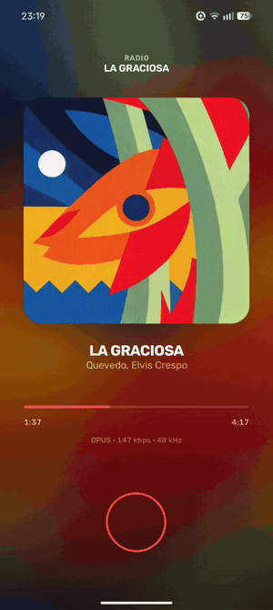
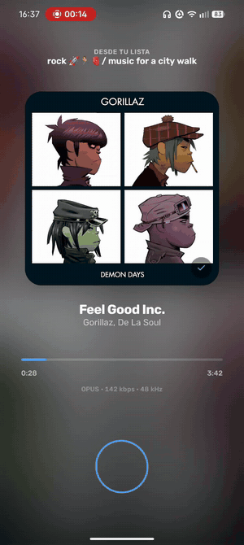
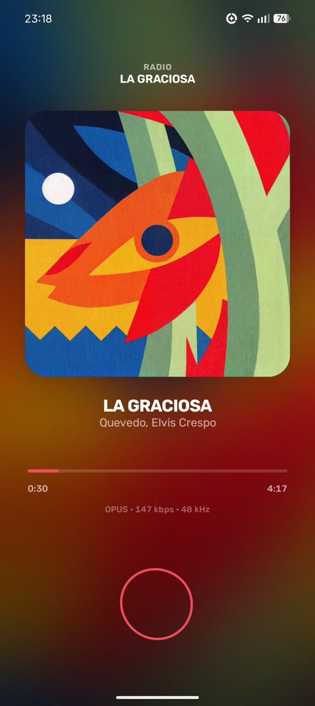
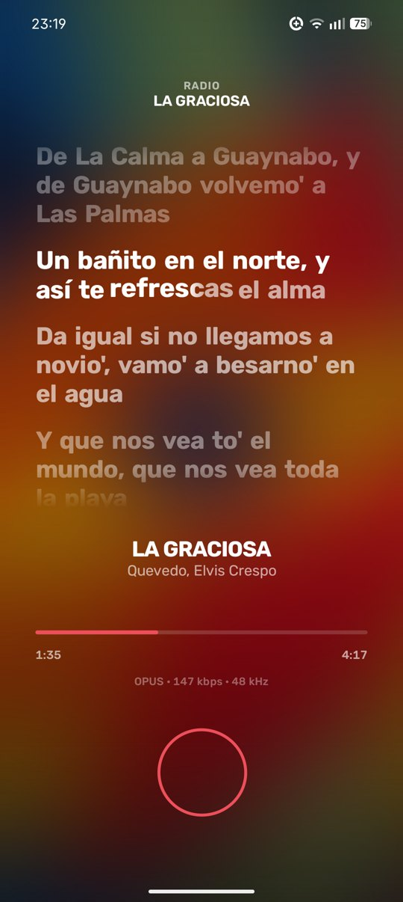
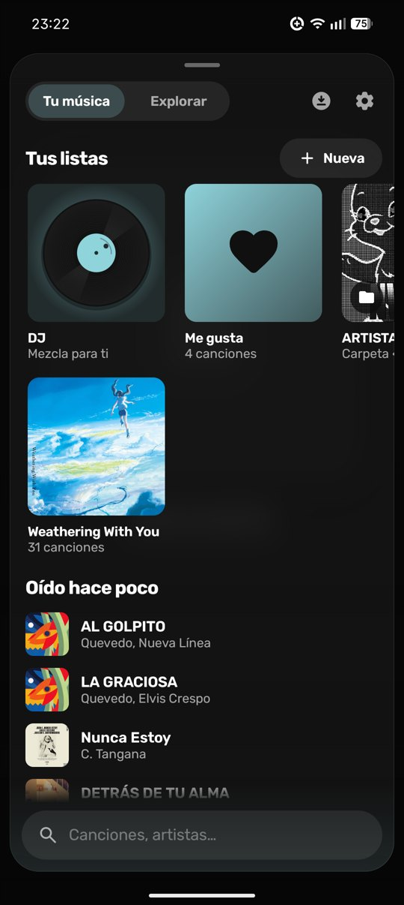
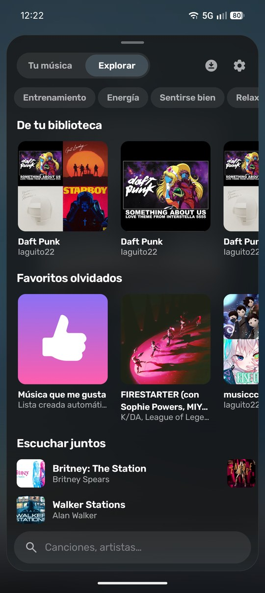
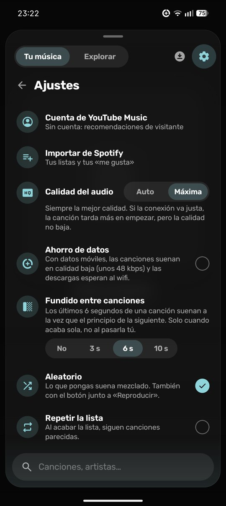

# Oto 音

Reproductor de música para Android sobre YouTube Music, sin pestañas ni botones: una gota que se maneja con gestos.

  
  &nbsp;&nbsp;
  

## Cómo se usa

| Gesto con la gota | Qué hace |
| --- | --- |
| Tocar | Pausa o sigue |
| A la derecha | Siguiente |
| A la izquierda | La anterior |
| Arriba | Tu música, Explorar y el buscador |
| Abajo | La letra |
| Mantener | La cola |
| Doble toque en la carátula | Me gusta |

La gota es un aro fino del color de la canción, o la gota líquida de antes (en Ajustes). Las dos laten con los graves, y la carátula también, un poco.

  
  
  

  
  

## Qué tiene

- **Letra sincronizada palabra a palabra** cuando la fuente lo trae, con los coros aparte y la pronunciación debajo del japonés, chino, coreano o cirílico. Se busca en cuanto empieza la canción y se guarda en el móvil: abrirla es al momento.
- **Tus listas y carpetas**, con Me gusta y el DJ. Se fijan arriba y se recolocan arrastrando («Mover», manteniendo cualquiera).
- **Importar de Spotify** tus listas y tus me gusta, con la extensión de Spicetify de [`tools/spicetify`](tools/spicetify).
- **Cuenta de YouTube Music** (opcional): recomendaciones tuyas y una copia de tus listas en tu cuenta, que vuelven solas al reinstalar.
- **DJ**: una mezcla continua de lo tuyo, lo que te falta de tus artistas y artistas nuevos, que aprende de cuánto te quedas con cada canción.
- **Hecho con lo tuyo** en Explorar: En bucle, mezclas de tus artistas, lo que hace tiempo que no oyes y lo mejor del DJ.
- **Android Auto**: tu música, lo oído hace poco, el DJ y la búsqueda (también por voz) en el coche.
- **Descargas** de listas o canciones sueltas, para oír sin conexión.
- **Calidad Auto o Máxima**, ahorro de datos y precarga de las siguientes canciones.
- Aleatorio que separa artistas, bucle, canciones parecidas al acabar una lista, fundido entre canciones, cola editable y salida de audio.

## Instalar

Descarga el APK de la [última versión](https://github.com/iaguito22/oto/releases/latest) y ábrelo en el móvil. Android 13 o más. No está en Play Store.

## Hecho con

- Kotlin · Jetpack Compose · Media3
- [InnerTubeX](https://github.com/MetrolistGroup/innertubex) para la extracción de streams
- El módulo `innertube/` viene de [Metrolist](https://github.com/MetrolistGroup/Metrolist) (GPL-3.0)
- Letras de lyricsplus, NetEase, [LRCLIB](https://lrclib.net) y YouTube Music

## Licencia

GPL-3.0
