# Oto 音

Reproductor de música para Android y escritorio sobre YouTube Music. En el móvil se maneja con una gota y gestos; en el ordenador, con ventanas que se unen como una sola. Los dos se vinculan y comparten tus listas.

  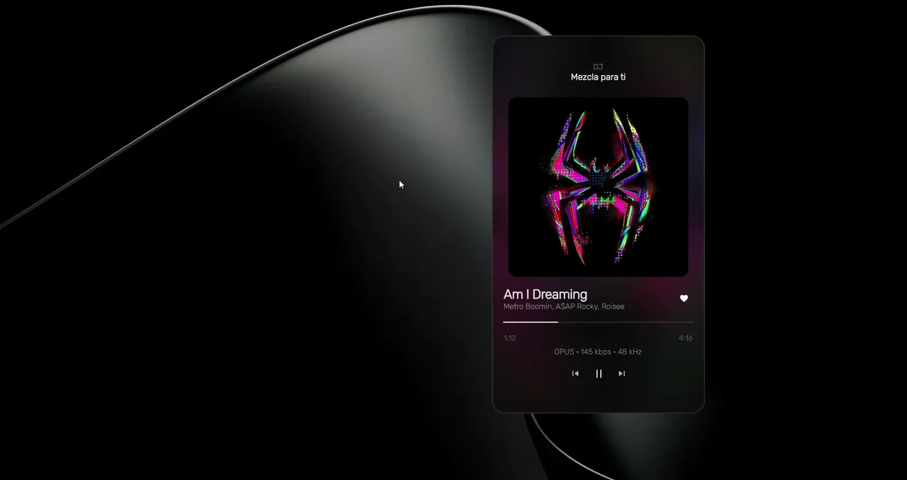

- [Instalar](#instalar)
- [En el ordenador](#en-el-ordenador)
- [En el móvil](#en-el-móvil)
- [En los dos](#en-los-dos)
- [Para desarrollar](#para-desarrollar)

## Instalar

Descargas de [Oto 2.1.0](https://github.com/iaguito22/oto/releases/tag/v2.1.0):

| Sistema | Paquete |
|---|---|
| Windows x64 | MSI con instalador de Oto |
| Ubuntu/Debian amd64 | DEB; instalar con `sudo apt install ./oto_2.1.0_amd64.deb` |
| Arch Linux x86_64 | Paquete nativo; instalar con `sudo pacman -U ./oto-2.1.0-1-x86_64.pkg.tar.zst` |
| Android 13 o superior | `Oto-2.1.0-android.apk`, paquete público `io.github.iaguito22.oto` |
| Android 12 | `Oto-2.1.0-android12.apk`, paquete aparte `io.github.iaguito22.oto.android12`, para móviles con Android 12 o 12L |

El APK público actualiza las versiones públicas anteriores. No está en Play Store.

Los paquetes Linux incluyen Java y dependen de FFmpeg. El MSI de Windows todavía no está firmado con Authenticode, así que SmartScreen puede mostrar un aviso de reputación. Los hashes van adjuntos a cada release.

## En el ordenador

Oto se reparte en ventanas: **reproductor**, **tu música**, **letra** y **cola**. Abre las que quieras y se colocan juntas, con un mismo fondo, como si fueran una sola. Al abrirlo por primera vez, una bienvenida enseña estos cinco gestos.

<table>
  <tr>
    <td width="50%"></td>
    <td width="50%">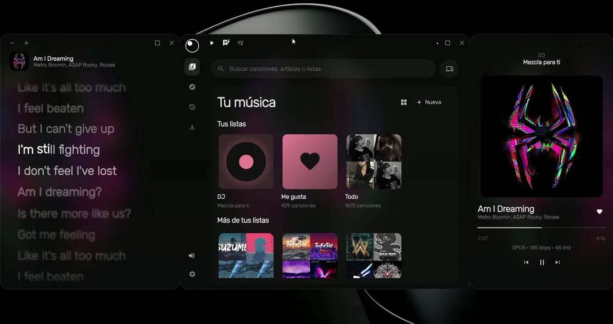</td>
  </tr>
  <tr>
    <td><b>Une las ventanas.</b> Ábrelas con los botones del reproductor y se acoplan solas. Por defecto: letra a la izquierda, tu música en el medio, reproductor a la derecha y la cola aparte.</td>
    <td><b>Cambia el orden.</b> Arrastra la barra superior de una ventana sobre otra y se intercambian. La del punto (·) es la principal: con ella mueves todo el conjunto.</td>
  </tr>
  <tr>
    <td>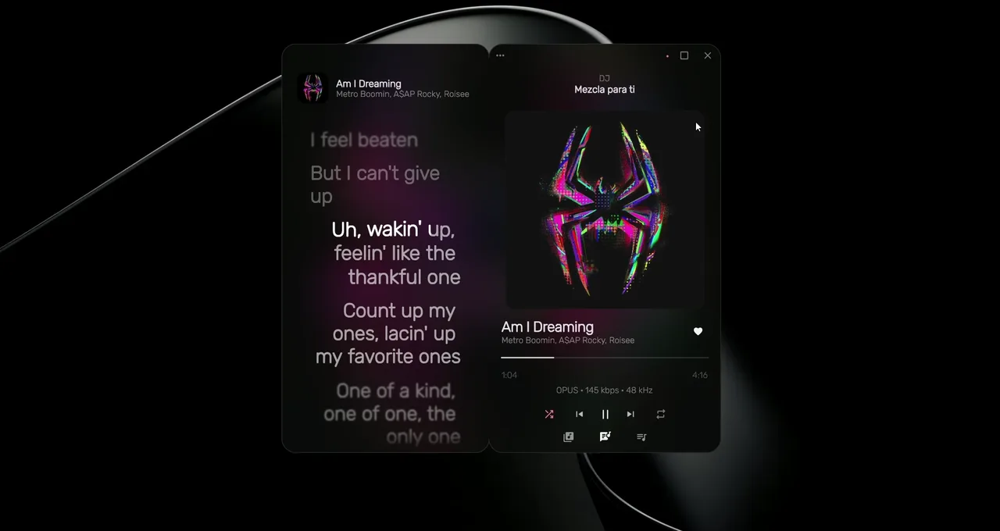</td>
    <td>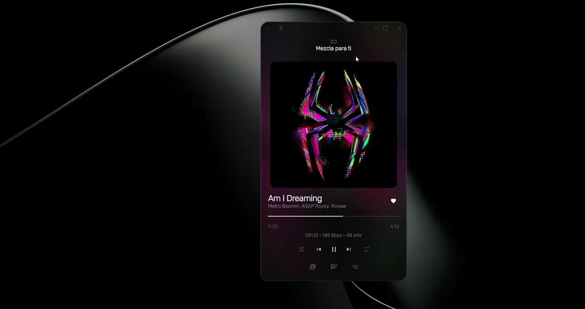</td>
  </tr>
  <tr>
    <td><b>Ajusta el tamaño.</b> Arrastra la unión entre dos ventanas para repartir el espacio, o los bordes y las esquinas para cambiar el conjunto entero, también maximizado.</td>
    <td><b>Elige tu reproductor.</b> En ··· cambia entre carátula, horizontal y vertical. El pequeño se puede fijar encima de todo con la chincheta.</td>
  </tr>
  <tr>
    <td>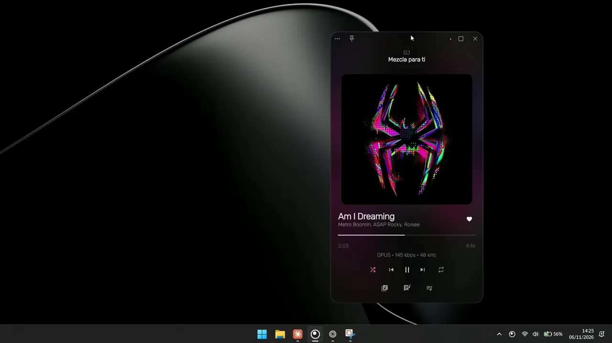</td>
    <td valign="top"><b>Escóndelo y vuelve.</b> <kbd>Ctrl</kbd> + <kbd>Alt</kbd> + <kbd>O</kbd> oculta o recupera Oto desde cualquier sitio (se cambia en Ajustes). La X lo deja en la bandeja, junto al reloj, con la canción actual a mano.</td>
  </tr>
</table>

Además:

- **Letra** en su propia ventana, palabra a palabra cuando la fuente lo trae, con tamaño ajustable.
- **Exportar a MP3** lo descargado, con sus etiquetas, a la carpeta que elijas.
- **Gráfica dedicada** (Windows, en Ajustes) para portátiles con dos gráficas, y **ahorro de RAM** para equipos justos.
- Si suena algo en el móvil vinculado, el reproductor del ordenador lo muestra y lo controla.

## En el móvil

Todo gira alrededor de **la gota**, abajo en el centro:

| Gesto | Qué hace |
|---|---|
| Tocar | Pausa o sigue |
| Deslizar a la derecha / izquierda | Siguiente / anterior (te dice cuál) |
| Deslizar arriba | Abre el menú: tu música, Explorar y búsqueda |
| Deslizar abajo | Letra o carátula |
| Mantener | La cola |

  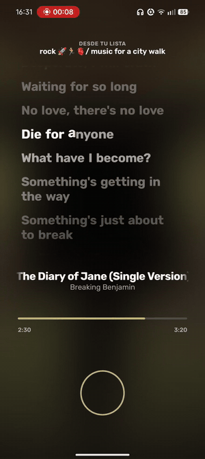
  &nbsp;&nbsp;
  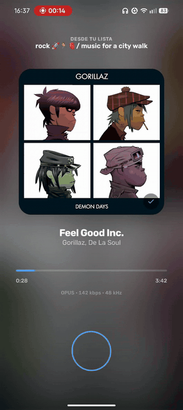

  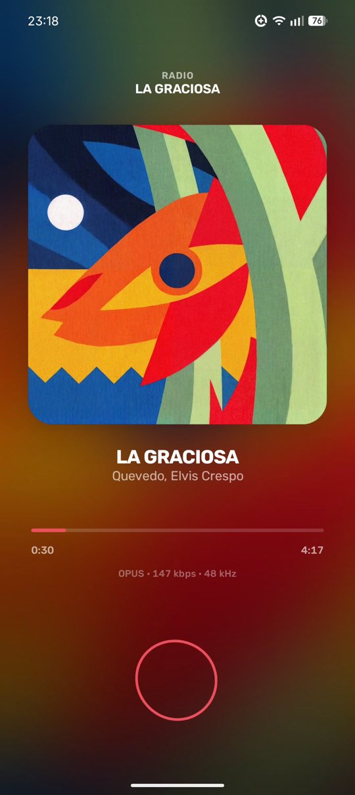
  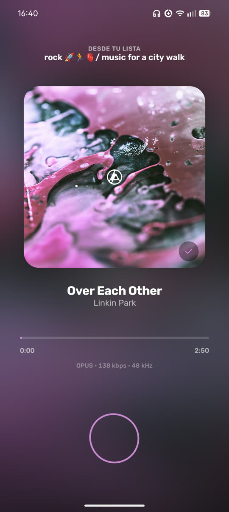
  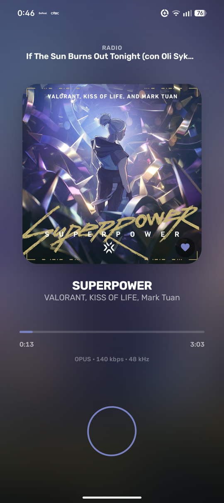

  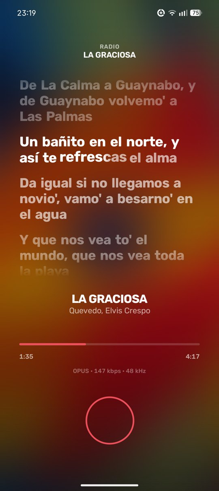
  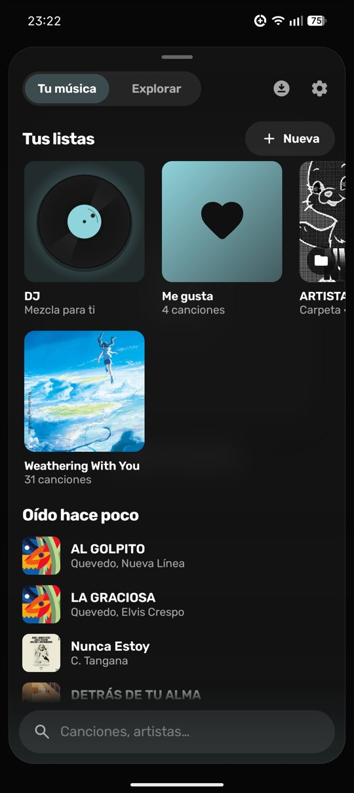
  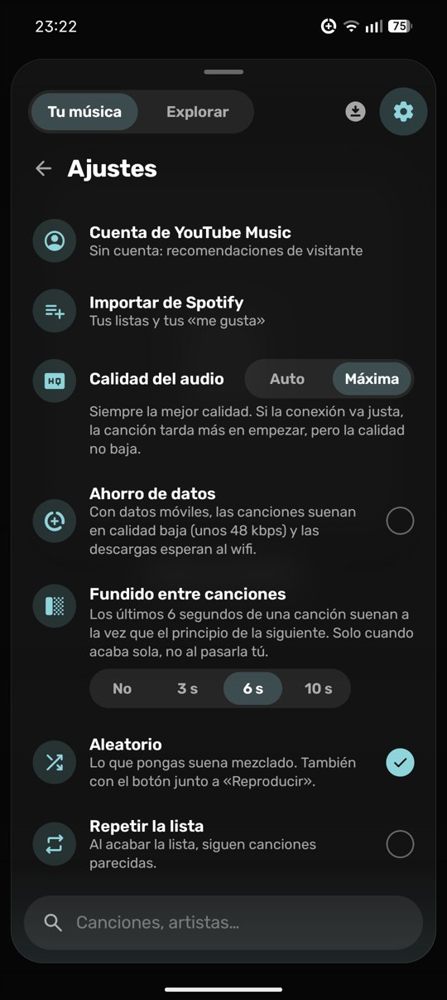

  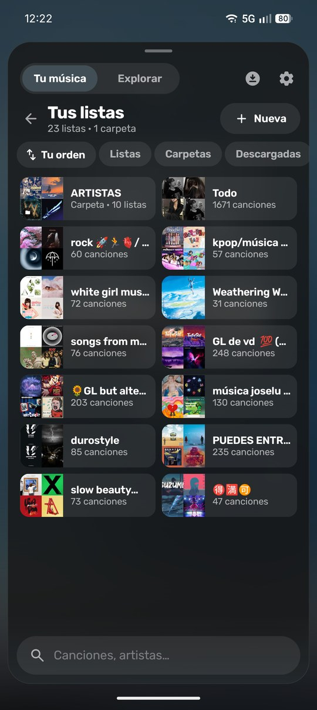
  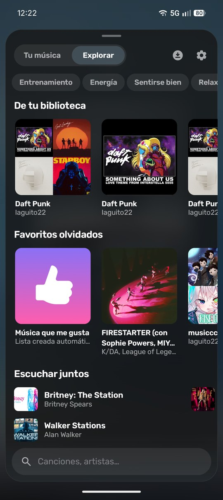
  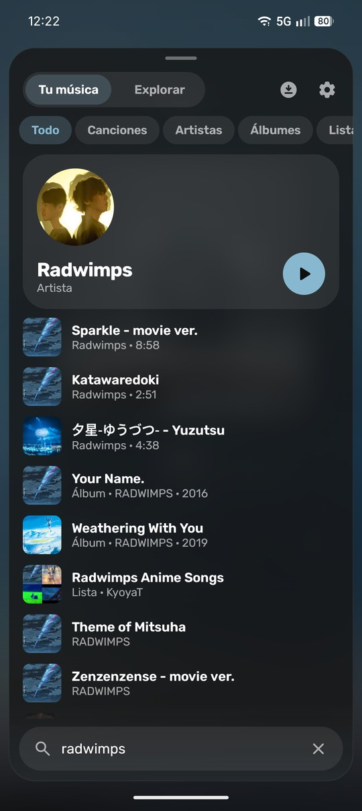

Además:

- **La carátula manda:** su color tiñe toda la pantalla, y la carátula y el aro laten con los graves.
- **Listas y carpetas** fijadas arriba y recolocables («Mover», manteniendo cualquiera); las oídas hace poco salen debajo, y todas en «Todas tus listas», con orden y filtros.
- **Android Auto:** tu música, lo oído hace poco, el DJ y la búsqueda (también por voz) en el coche.
- **Lo del ordenador en la pantalla de bloqueo:** si el móvil sigue lo que suena en el PC, su notificación pasa a ser un reproductor que lo controla.

## En los dos

- **Vincular móvil y ordenador** desde «Dispositivos» con un QR, en la misma red. Se sincronizan tus listas y Me gusta de Oto; puedes pasar la música de uno a otro, controlar el otro y añadir canciones a su cola. Depende también del cortafuegos.
- **Letra sincronizada palabra a palabra** cuando la fuente lo trae, con los coros aparte y la pronunciación debajo del japonés, chino, coreano o cirílico. Se guarda en el aparato: abrirla es al momento.
- **DJ:** una mezcla continua de lo tuyo, lo que te falta de tus artistas y artistas nuevos. Aprende de cuánto te quedas con cada canción; lo que guardas en tus listas pesa más que un Me gusta.
- **Hecho con lo tuyo,** en Explorar: En bucle, mezclas de tus artistas, lo que hace tiempo que no oyes y lo mejor del DJ.
- **Tu resumen,** también en Explorar: lo que más escuchas en ese aparato, tus artistas, mes a mes y tu hora.
- **Importar de Spotify** tus listas y tus Me gusta, con la extensión de Spicetify de [`tools/spicetify`](tools/spicetify) (se instala pegando una línea).
- **Cuenta de YouTube Music** (opcional): recomendaciones tuyas y una copia de tus listas en tu cuenta, que vuelven solas al reinstalar.
- **Descargas** de listas o canciones sueltas, para oír sin conexión.
- **Calidad Auto o Máxima,** ahorro de datos y precarga de las siguientes canciones.
- Aleatorio que separa artistas, bucle, canciones parecidas al acabar una lista, fundido entre canciones y cola editable.

## Para desarrollar

- `app/`: aplicación Android y conexión con el escritorio.
- `desktopApp/`: aplicación de escritorio y sus ventanas modulares.
- `core/`: preferencias, biblioteca, reproducción, DJ y protocolo compartidos.
- `innertube/`: integración con YouTube Music utilizada por ambas aplicaciones.

La rama común de desarrollo y publicación para todos los sistemas es `main`. Véase [Publicación](docs/PUBLICACION.md) para compilar paquetes y mantener las identidades de firma.

### Hecho con

- Kotlin · Jetpack Compose · Media3
- [InnerTubeX](https://github.com/MetrolistGroup/innertubex) para la extracción de streams
- El módulo `innertube/` viene de [Metrolist](https://github.com/MetrolistGroup/Metrolist) (GPL-3.0)
- Letras de lyricsplus, NetEase, [LRCLIB](https://lrclib.net) y YouTube Music

## Licencia

GPL-3.0
